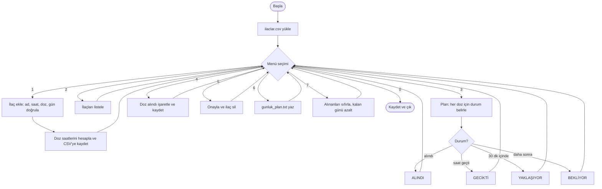

# GEP1316 – Ara Değerlendirme Ödevi 1: Süreç Belgesi

**Proje:** İlaç / Tedavi Saatleri Hatırlatıcı Planlayıcı
**Öğrenci:** Deniz Albayrak  **Dosya adı:** GEP1316_Odev1_DenizAlbayrak
**GitHub deposu:** https://github.com/denizalbayrk/ilac-hatirlatici

## 1. Problem ve kullanıcı
Düzenli ilaç kullanan kişiler (kronik hastalar, bakım verenler, yaşlı yakınları olan aileler) birden fazla ilacın farklı saatlerini aklında tutmakta zorlanır; bir dozu unutmak ya da çifte almak riskli olabilir. Uygulama, kullanıcının girdiği ilaç adı, ilk doz saati, günlük doz sayısı ve tedavi süresine göre doz saatlerini otomatik hesaplar, bugünün planını gösterir ve geciken / yaklaşan dozları hatırlatır. Program tıbbi tavsiye vermez, yalnızca saat düzenler; kişisel sağlık verisi toplamaz.

## 2. Tasarım (akış şeması)

**Sözde kod (doz hesabı):** `aralık = 1440 // günlük_doz` → `i = 0 … doz-1` için `saat = (başlangıç + i × aralık) mod 1440`. Gece yarısını aşan dozlar ertesi güne sayılır (+1440 dk).

## 3. Veri yapısı
İlaçlar bir **liste**, her ilaç bir **sözlüktür**: `{"ad", "saatler", "gun", "alinan"}`. Kalıcı saklama `ilaclar.csv`, okunabilir rapor `gunluk_plan.txt`.

## 4. YZ ile çalışma günlüğü (özet; ayrıntı `PROMPTLAR.md`)
| # | Prompt (özet) | YZ çıktısı | Kararım |
|---|---|---|---|
| 1 | Ödev görsellerini verip ilaç hatırlatıcı uygulaması istedim | Gereksinim eşlemeli plan | **Kabul**; "yeni güne geç" menüsü uygulamada eklendi |
| 2 | Planı onaylayıp uygulamayı istedim | Kod, testler, belgeler | **Kabul, doğrulama sonrası**: 29 testi ve hatalı girdileri kendim çalıştırıp denedim |
| 3 | Kodu satır satır açıklamasını istedim (sözlü doğrulama hazırlığı) | `KOD_REHBERI.md` | **Kabul**; kodla karşılaştırarak okudum |
| 4 | GitHub bilgilerimi verip commit/push yapmasını istedim | Şifreyi girmedi, giriş için beni yönlendirdi; başka hesaba push etmeden durdu; depoyu oluşturup push etti | **Kabul**; depoyu public + noreply e-posta ile açtırdım |

**YZ'nin eksik bıraktığı nokta:** Plan "ilk dozdan başlayan 24 saatlik döngü" olarak tasarlandığı için 22:00 başlangıçlı ilacın 10:00 dozu öğlen "BEKLİYOR" görünüyordu; "GECİKTİ" olması beklenebilirdi. Bunu elle çalıştırırken yakaladım; tasarımı basit tutmak için **kabul edip** README'ye "bilinen sınırlama" olarak yazdım.

## 5. Test ve hata ayıklama
`python -m unittest -v` → **29 test, hepsi geçti.** Öne çıkan senaryolar (tam tablo `README.md`'de):

| Girdi | Beklenen | Gerçek |
|---|---|---|
| `08:00` | geçerli | geçerli |
| `25:99` / `abc` / boş | reddedilir | reddedildi |
| `24:00`, `00:00` | reddedilir, geçerli | reddedildi, geçerli |
| günlük doz `0`, `-3`, `13` | uyarı, tekrar sorar | uyarı + tekrar sorma |
| 08:00 + 3 doz | `08:00, 16:00, 00:00` | aynı |
| saat 23:30, 00:00 dozu | YAKLAŞIYOR (30 dk) | aynı |
| bozuk CSV satırı | atlanır, çökmez | atlandı |

**En zor kısım:** Gece yarısını aşan dozların doğru sıralanması ve "ne kadar sonra / geciken" hesabı. Çözüm: ilk dozdan önce görünen saatlere 1440 dakika eklemek (`doz_dakikalari`). Bu mantığı ayrı testlerle (23:30 → 00:00 dozu) doğruladım. Testlerde başarısız olan bir senaryo çıkmadı; bu yüzden gerçekte yaşanmamış bir hata yazılmadı.

## 6. Yansıtma
Bu ödevde bir problemi önce kâğıt üzerinde parçalara ayırmanın, kod yazmaktan daha önemli olduğunu öğrendim. İlaç saatlerini hesaplamak ilk bakışta basit görünse de gece yarısını geçen dozlar, "geciken" ile "yaklaşan" dozun ayrımı ve tedavi süresi bitince ilacın plandan çıkması gibi karar noktaları ortaya çıktı. Bunları if/elif/else yapılarıyla, tekrar eden işleri döngülerle, ortak işleri fonksiyonlarla çözmenin kodu okunabilir kıldığını gördüm.

Yapay zekâyı "yardımcı geliştirici" gibi kullandım: gereksinimleri verdim, planı onayladım, ürettiği kodu çalıştırıp test ettim. YZ hızlıca çalışan bir iskelet çıkardı, ama doğrulama benim sorumluluğumdaydı. Elle çalıştırırken 24 saatlik döngü tasarımının bir sınırlaması olduğunu fark ettim ve bunu gizlemek yerine belgelemeyi seçtim. Girdi doğrulamanın (hatalı saat, negatif sayı, boş metin) programı çökmekten koruduğunu da somut olarak gördüm.

YZ olmadan bu kapsamda bir uygulamayı, testlerle ve belgelerle birlikte yazmam benim için çok daha uzun sürerdi; tahminen yalnızca temel menüyü ve doz hesabını yapabilirdim. Dosyaya kaydetme, `unittest` ile otomatik test ve sahte girdiyle test yazma gibi konuları YZ'nin kodunu okuyarak öğrendim.

Mesleğimde bu beceriyi, yinelenen ve hataya açık işleri (hatırlatma, takip, raporlama) küçük araçlara dönüştürmek için kullanabilirim. Bir YZ çıktısını körü körüne kabul etmeden test etmek ve gerekçesiyle kabul/red kararı vermek, sağlık gibi hata maliyetinin yüksek olduğu alanlarda özellikle önemlidir. Bu ödev, programlamayı ezberlenecek bir konu olarak değil, adım adım çözülen bir problem olarak görmemi sağladı. Bir sonraki projemde de önce planı yazmayı, sonra kodlamayı ve her aşamada testleri çalıştırmayı alışkanlık hâline getirmek istiyorum.

## 7. Öğrenci Yapay Zekâ Kullanım Beyan Formu
| Alan | Yanıtınız |
|---|---|
| Kullanılan YZ aracı/araçları | Claude Code (Claude Sonnet 5.5, Anthropic) |
| Kullanma amacı | Kod üretimi, test yazımı, hata ayıklama, README ve rapor taslağı hazırlama |
| Kontrol ve sorumluluk | Yapay zekâ tarafından üretilen içeriği gözden geçirdiğimi, gerekli düzeltmeleri yaptığımı ve teslim ettiğim çalışmanın doğruluğundan ve akademik dürüstlüğünden sorumlu olduğumu beyan ederim. |
| Öğrencinin adı-soyadı | Deniz Albayrak |
| Tarih ve İmza | 14.11.2026 / |

## 8. Kaynakça (APA 7)
Anthropic. (2026). *Claude* [Büyük dil modeli]. https://claude.ai
